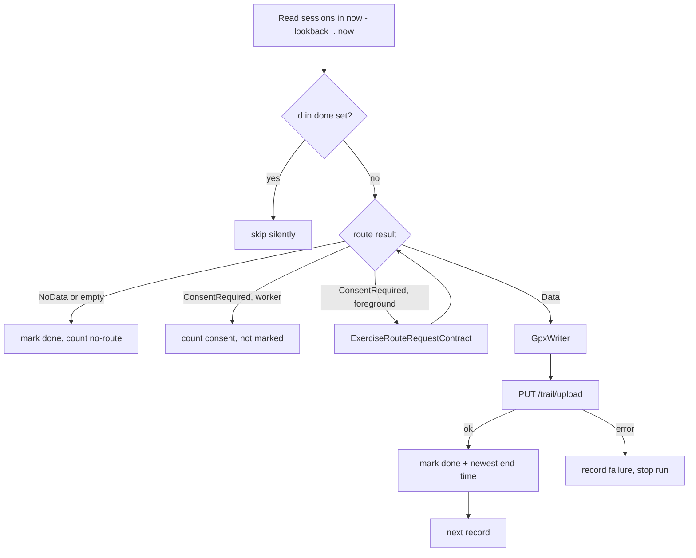

# Design

Wanderer Sync bridges two systems on the phone itself, with no cloud
intermediary:


Single user, single server. It runs periodically in the background, never
uploads the same workout twice, and can be driven manually from its one
screen.

Out of scope: Komoot, Strava, Google Drive, writing into Health Connect,
multi-account, Play Store publishing.

All identifiers in this document are placeholders
(`https://wanderer.example.com`, `alice`). See the sanitization rules in
`AGENTS.md`.

## Components

```
app/src/main/java/ru/vehq/hcsync/
  MainActivity.kt           — Compose host, permission launchers, rationale screen
  model/Workout.kt          — Workout / RouteResult / RoutePoint (pure Kotlin)
  model/ExerciseTypes.kt    — EXERCISE_TYPE_* → label
  ui/SyncScreen.kt          — the one screen
  ui/ProbeReport.kt         — pure function: workouts → copyable text
  hc/HealthConnectSource.kt — reads sessions + routes → domain objects
  hc/HealthConnectPermissions.kt — SDK status, granted set, requestable set
  gpx/GpxWriter.kt          — pure function: Workout -> String
  wanderer/WandererClient.kt— login, upload, cookie jar, one 401 retry
  sync/SyncEngine.kt        — read → filter done → gpx → upload → persist (pure Kotlin)
  sync/SyncWorker.kt        — CoroutineWorker wiring real deps into SyncEngine
  data/Settings.kt          — DataStore: server url, interval, history opt-in
  data/SyncState.kt         — DataStore: done ids, totals, newest uploaded end, last run/result
  data/Secrets.kt           — EncryptedSharedPreferences: Wanderer API token
  sync/SyncScheduler.kt     — enqueues the unique PeriodicWorkRequest
```

`SyncEngine` is pure Kotlin: `HealthConnectSource`, `WandererClient` and
`SyncStateStore` are small interfaces injected by hand, so the engine is
unit-tested on the JVM without an emulator.

## Health Connect (read side)

Facts below were taken from the `connect-client` docs at design time; verify
against the pinned SDK version and update this section if anything moved.

- Workouts are `ExerciseSessionRecord`s, read with
  `HealthConnectClient.readRecords(ReadRecordsRequest(ExerciseSessionRecord::class, timeRangeFilter))`,
  following `pageToken` until exhausted.
- `record.exerciseRouteResult` has three shapes, all handled:
  - `ExerciseRouteResult.Data` → `.exerciseRoute.route` is a
    `List<ExerciseRoute.Location>` with `time`, `latitude`, `longitude`,
    `altitude?`, `horizontalAccuracy?`. This is the track.
  - `ExerciseRouteResult.ConsentRequired` → bulk route permission not granted.
    Only the foreground "Sync now" path requests per-record consent via
    `androidx.health.connect.client.contracts.ExerciseRouteRequestContract`
    (`ActivityResultContract<String /*record id*/, ExerciseRoute?>`). The
    background worker skips the record and counts it.
  - `ExerciseRouteResult.NoData` → the writing app stored no route. Skip,
    count, never retry.
- Runtime permissions (declared in the manifest, requested with
  `PermissionController.createRequestPermissionResultContract()`):
  - `android.permission.health.READ_EXERCISE`
  - `android.permission.health.READ_EXERCISE_ROUTES` — bulk route access,
    avoids per-record consent dialogs. **Not grantable from the app**: the
    request contract ignores it and the normal permission list does not show
    it. The user must open Health Connect → App permissions → Wanderer Sync →
    *Additional access* → *Exercise routes* → *Always allow*. The app only
    detects the grant (`getGrantedPermissions()`), explains the three taps and
    deep-links into Health Connect settings. Source: OpenVitals onboarding
    and its issue #226 (same watch, same symptom).
  - `android.permission.health.READ_HEALTH_DATA_IN_BACKGROUND` — needed for
    WorkManager reads; API 35+, requested conditionally.
  - `android.permission.health.READ_HEALTH_DATA_HISTORY` — only when the
    "include history before install" setting is on (default off); without it
    the first sync reaches back 30 days.
- Health Connect requires rationale declarations in the manifest
  (`androidx.health.ACTION_SHOW_PERMISSIONS_RATIONALE` intent-filter and the
  API-34 `VIEW_PERMISSION_USAGE` activity-alias). They are copied from
  Google's `health-samples` repository; the source is noted in a comment.
- `HealthConnectClient.getSdkStatus()` is checked before anything else;
  unavailable / needs-update states are shown on screen.
- There is no `HealthPermission.PERMISSION_READ_EXERCISE_ROUTES` constant in
  `connect-client` 1.1.0; the permission string is written out literally.
- `exerciseType` is an int constant (`EXERCISE_TYPE_WALKING`, `_HIKING`,
  `_BIKING`, `_RUNNING`, …). Common ones map to a human label; everything
  else is "Workout".
- Dedup key: `record.metadata.id` (the Health Connect record UUID).

## Wanderer (write side)

Docs: https://wanderer.to/guides/api and
https://github.com/Flomp/wanderer/wiki/API. The facts below were verified
against the Wanderer source at commit `58d2e3d` (2026-10-25),
`web/src/hooks.server.ts`, `web/src/routes/api/v1/{auth/login,trail/upload}/+server.ts`
and `web/src/lib/util/gpx_util.ts`.

- Base URL: `http(s)://<host>/api/v1`.
- **Auth, preferred: API token.** Wanderer issues per-user API tokens under
  Settings → Account → API tokens (they start with `wanderer_key`). Send
  `Authorization: Bearer <token>` on every `/api/*` call; the server verifies
  it against `/auth/token` per request and answers `401 {"message":
  "invalid_token"}` when revoked. No login round-trip, no password on the
  phone, no cookie to persist.
- Auth, fallback: `POST /auth/login` with JSON `{"username": "...",
  "password": "..."}` (or `email`; password 8–72 chars). The response body is
  the PocketBase auth record and the response carries `Set-Cookie: pb_auth=…`
  (`SameSite=Lax`, not HttpOnly). Later calls send that cookie. Only needed if
  the server has API tokens disabled.
- **Upload is multipart, not a raw body.** `PUT /trail/upload` with
  `multipart/form-data`: field `file` = the GPX file, optional `name`
  (fallback trail name), optional `ignoreDuplicates` = `"true"`. Response
  `201` with the created trail JSON (`id`, `name`, …); `400` for an empty or
  unparsable file; `401` unauthenticated.
- **Duplicate detection** compares distance, elevation gain and loss of the
  new trail with existing ones (all within 50 m → `400 {"message":
  "Duplicate trail", "id": …}`). A daily walk on the same loop would be
  rejected, so the client always sends `ignoreDuplicates=true`; our own
  dedup is by Health Connect record id.
- How the trail is filled from the GPX: `name` ← `metadata/name`, else
  `trk/name`, else the `name` form field; `description` ← **`metadata/desc`**
  (not `trk/desc`); `date` ← time of the first track point; `lat`/`lon` ←
  first track point. Elevation may be corrected server-side.
- Everything else is standard PocketBase CRUD under `/api/v1/<collection>`;
  not used. A later `PATCH` on the trail to set category is optional polish
  (TODO, not implemented).
- Heart rate / cadence: Wanderer's GPX parser preserves Garmin
  `TrackPointExtension` (`gpxtpx:hr`, …) in the stored file but does not
  display or index it. Not emitted in v1; Health Connect keeps heart rate in
  separate `HeartRateRecord`s (extra permission) and would need joining by
  time.

## GPX output

GPX 1.1, one `<trk>` with one `<trkseg>`.

| Element | Value |
|---|---|
| `<metadata><time>` | session start, ISO-8601 UTC |
| `<trk><name>` | `"<Type label> <start time, local tz, yyyy-MM-dd HH:mm>"` |
| `<trk><type>` | the type label |
| `<metadata><desc>` | the Health Connect record id, for tracing (Wanderer maps it to the trail description) |
| `<trkpt lat lon>` | per location |
| `<trkpt><ele>` | only when altitude is present |
| `<trkpt><time>` | ISO-8601 UTC |

Output is validated once in a unit test against the GPX 1.1 XSD bundled as a
test resource.

## Sync engine rules



1. The read window is always `now - lookback` to `now`: 30 days, or ten
   years when the history setting is on **and** `READ_HEALTH_DATA_HISTORY`
   was granted. Re-reading the window every run is cheap (dozens of
   records) and keeps the logic stateless apart from the done-id set.
2. Records whose id is in the done set are skipped without counting.
3. `NoData` (or a `Data` route with zero points) is final: the id is marked
   done so it is never re-reported. `ConsentRequired` is counted but not
   marked, so it uploads once the user grants route access.
4. Records are processed oldest first. After each successful upload the id
   is added to the done set and the newest uploaded end time is updated,
   before the next record starts. A failure stops the run; earlier uploads
   stay recorded, the failed record is retried next run.
5. Failures are *retryable* (WorkManager backoff) for IO errors, 5xx, 408
   and 429; a 401 (bad token) or 400 (bad file) is reported and not retried.
6. The run's summary (`uploaded N, no route N, consent needed N, failed: …`)
   and its time are stored for the status area.

## Scheduling

`SyncWorker` is a `PeriodicWorkRequest`. Constraints come from settings:
network `UNMETERED` (Wi-Fi) by default or `CONNECTED` when "only on Wi-Fi"
is off, plus `requiresCharging` when "only while charging" is on. Default
interval 60 min, user-settable; WorkManager's minimum is 15 min. It is
(re-)enqueued with `ExistingPeriodicWorkPolicy.UPDATE` whenever settings
are saved.

## Screen

Fields: server URL, API token (password-masked), sync interval, toggles for
Wi-Fi only, charging only and "include workouts older than 30 days". Buttons: Save & schedule, Test
connection (`GET /api-token`), Grant permissions, Open Health Connect, Sync
now (foreground, resolves `ConsentRequired` through the route contract),
Probe (lists the last 30 days of sessions with type, start, route status and
point count), Copy. Status: Health Connect SDK status, per-permission ✔/✘,
running totals (trails uploaded, sessions without route), last run with
the number of sessions seen in the window, last result, and a monospace
output area for probe / sync text. Save and Test connection report in a
one-line notice under their own buttons; Sync now and Probe under theirs.

## Security / logging

- Password and session cookie live only in `EncryptedSharedPreferences` and
  are never logged at any level.
- Successful uploads log the Wanderer trail id and the Health Connect record
  id. Worker logs are tagged `SyncWorker` (`adb logcat -s SyncWorker`).
- Network calls and Health Connect reads run on `Dispatchers.IO` only.

## Prior art

[OpenVitals](https://github.com/OpenVitals-MTU/android-app) (AGPL-3, same
licence as this repo) reads the same Health Connect records from the same
watch and exports GPX. Borrow from it rather than re-deriving:

- `healthconnect/HealthConnectMappers.kt` — `ExerciseRouteResult` → points
  (`Data` / `ConsentRequired` / `NoData`, plus an `else` branch because the
  type is not sealed).
- `healthconnect/HealthConnectPermissionService.kt` — history and background
  permissions are only requested when `HealthConnectFeatures` reports the
  feature available; `READ_EXERCISE_ROUTES` is handled as a manual toggle.
- `features/activity/ActivityRouteExport.kt` — `XmlSerializer`-based GPX 1.1
  writer (`creator`, `trk/name/desc/trkseg/trkpt/ele/time`).
- `AndroidManifest.xml` — `ACTION_SHOW_PERMISSIONS_RATIONALE` activity and
  the `VIEW_PERMISSION_USAGE` activity-alias guarded by
  `START_VIEW_PERMISSION_USAGE`, plus `<queries>` intents for opening Health
  Connect settings.
- Its `onboarding_routes_*` strings are the user-facing wording for the
  three-tap route permission.

Anything copied keeps the attribution header and a row in
`THIRD_PARTY_NOTICES.md`, as required by `AGENTS.md`.

## Build toolchain notes

- `connect-client` 1.1.0 (newest stable as of 2026-10-26) verified with
  `javap` to contain `HealthConnectFeatures.FEATURE_READ_HEALTH_DATA_IN_BACKGROUND`
  / `FEATURE_READ_HEALTH_DATA_HISTORY`, the matching `HealthPermission`
  constants, `ExerciseRouteResult.{Data,ConsentRequired,NoData}` and
  `ExerciseRouteRequestContract`. `ExerciseRouteResult` is an abstract class,
  not sealed, so `when` needs an `else`.
- AGP 9 ships Kotlin built in; only the Compose compiler plugin is applied,
  and its version (`kotlin` in the catalog) drives the Kotlin version used.
- `compileSdk = 37`, `targetSdk = 36`, `minSdk = 34`.
