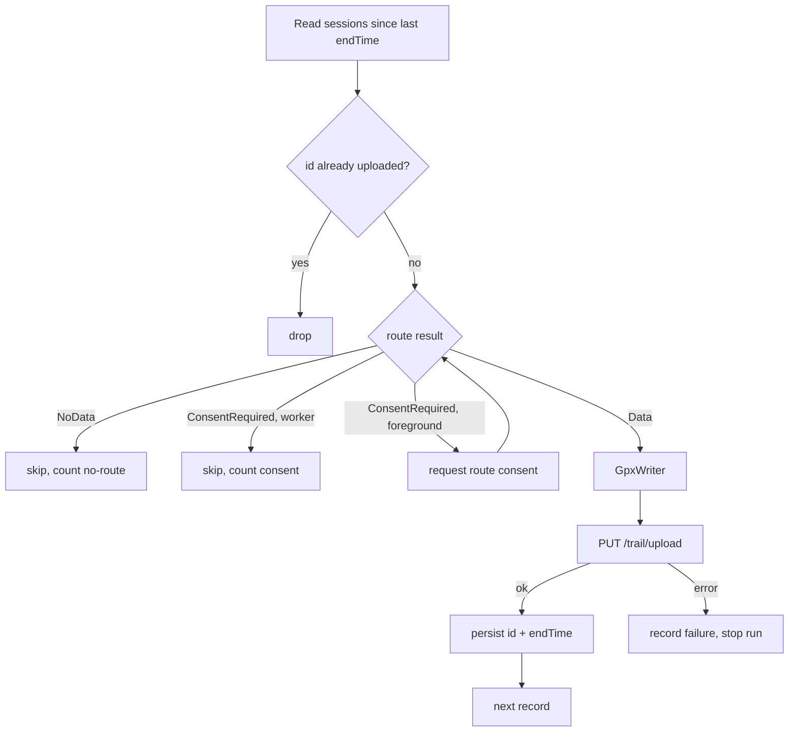

# Design

Wanderer Sync bridges two systems on the phone itself, with no cloud
intermediary:


Single user, single server. It runs periodically in the background, never
uploads the same workout twice, and can be driven manually from its one
screen.

Out of scope: Komoot, Strava, Google Drive, writing into Health Connect,
multi-account, Play Store publishing.

All identifiers in this document are placeholders
(`https://wanderer.example.com`, `alice`). See the sanitization rules in
`AGENTS.md`.

## Components

```
app/src/main/java/ru/vehq/hcsync/
  MainActivity.kt           — Compose host, permission launchers
  ui/SyncScreen.kt          — the one screen
  hc/HealthConnectSource.kt — reads sessions + routes → domain objects
  gpx/GpxWriter.kt          — pure function: Workout -> String
  wanderer/WandererClient.kt— login, upload, cookie jar, one 401 retry
  sync/SyncEngine.kt        — read → filter uploaded → gpx → upload → persist
  sync/SyncWorker.kt        — CoroutineWorker calling SyncEngine
  data/Settings.kt          — DataStore: server url, username, interval, history opt-in
  data/SyncState.kt         — DataStore: uploaded ids, last run, last result
  data/Secrets.kt           — EncryptedSharedPreferences: password, cookie
```

`SyncEngine` is pure Kotlin: `HealthConnectSource` and `WandererClient` are
small interfaces injected by hand, so the engine is unit-tested on the JVM
without an emulator.

## Health Connect (read side)

Facts below were taken from the `connect-client` docs at design time; verify
against the pinned SDK version and update this section if anything moved.

- Workouts are `ExerciseSessionRecord`s, read with
  `HealthConnectClient.readRecords(ReadRecordsRequest(ExerciseSessionRecord::class, timeRangeFilter))`,
  following `pageToken` until exhausted.
- `record.exerciseRouteResult` has three shapes, all handled:
  - `ExerciseRouteResult.Data` → `.exerciseRoute.route` is a
    `List<ExerciseRoute.Location>` with `time`, `latitude`, `longitude`,
    `altitude?`, `horizontalAccuracy?`. This is the track.
  - `ExerciseRouteResult.ConsentRequired` → bulk route permission not granted.
    Only the foreground "Sync now" path requests per-record consent via
    `PermissionController.createRequestExerciseRouteContract()`. The
    background worker skips the record and counts it.
  - `ExerciseRouteResult.NoData` → the writing app stored no route. Skip,
    count, never retry.
- Runtime permissions (declared in the manifest, requested with
  `PermissionController.createRequestPermissionResultContract()`):
  - `android.permission.health.READ_EXERCISE`
  - `android.permission.health.READ_EXERCISE_ROUTES` — bulk route access,
    avoids per-record consent dialogs. **Not grantable from the app**: the
    request contract ignores it and the normal permission list does not show
    it. The user must open Health Connect → App permissions → Wanderer Sync →
    *Additional access* → *Exercise routes* → *Always allow*. The app only
    detects the grant (`getGrantedPermissions()`), explains the three taps and
    deep-links into Health Connect settings. Source: OpenVitals onboarding
    and its issue #226 (same watch, same symptom).
  - `android.permission.health.READ_HEALTH_DATA_IN_BACKGROUND` — needed for
    WorkManager reads; API 35+, requested conditionally.
  - `android.permission.health.READ_HEALTH_DATA_HISTORY` — only when the
    "include history before install" setting is on (default off); without it
    the first sync reaches back 30 days.
- Health Connect requires rationale declarations in the manifest
  (`androidx.health.ACTION_SHOW_PERMISSIONS_RATIONALE` intent-filter and the
  API-34 `VIEW_PERMISSION_USAGE` activity-alias). They are copied from
  Google's `health-samples` repository; the source is noted in a comment.
- `HealthConnectClient.getSdkStatus()` is checked before anything else;
  unavailable / needs-update states are shown on screen.
- `exerciseType` is an int constant (`EXERCISE_TYPE_WALKING`, `_HIKING`,
  `_BIKING`, `_RUNNING`, …). Common ones map to a human label; everything
  else is "Workout".
- Dedup key: `record.metadata.id` (the Health Connect record UUID).

## Wanderer (write side)

Docs: https://wanderer.to/guides/api and
https://github.com/Flomp/wanderer/wiki/API. Verify before changing the
client; summary as understood at design time:

- Base URL: `http(s)://<host>/api/v1`.
- Login: `POST /auth/login` with JSON `{"username": "...", "password": "..."}`.
  The response sets an auth **cookie** that all later calls must send. The
  client keeps it in a persisting `CookieJar`; on any `401` it logs in again
  once and retries; a second `401` fails the run cleanly.
- Upload: `PUT /trail/upload`, `Content-Type: application/gpx+xml`, body =
  raw GPX bytes. Wanderer parses the file and creates a trail, inferring
  name/length/elevation. The response carries the created trail id, which is
  logged.
- Everything else is standard PocketBase CRUD under `/api/v1/<collection>`;
  not used. A later `PATCH` on the trail to set category/date is optional
  polish (TODO, not implemented).

## GPX output

GPX 1.1, one `<trk>` with one `<trkseg>`.

| Element | Value |
|---|---|
| `<metadata><time>` | session start, ISO-8601 UTC |
| `<trk><name>` | `"<Type label> <start time, local tz, yyyy-MM-dd HH:mm>"` |
| `<trk><type>` | the type label |
| `<trk><desc>` | the Health Connect record id, for tracing |
| `<trkpt lat lon>` | per location |
| `<trkpt><ele>` | only when altitude is present |
| `<trkpt><time>` | ISO-8601 UTC |

Output is validated once in a unit test against the GPX 1.1 XSD bundled as a
test resource.

## Sync engine rules




1. Read sessions from the last successful `endTime` (or 30 days back / full
   history on first run, per setting) to now.
2. Drop records whose id is already in the uploaded set.
3. Skip and count `NoData` and `ConsentRequired` routes (worker) — or request
   consent (foreground).
4. For each remaining record: build GPX → upload → **then** record the id and
   advance the newest `endTime`. State is persisted per successful upload, so
   a partial failure keeps earlier successes and retries only the rest.
5. Result summary (uploaded / skipped-no-route / skipped-consent / failed
   with reason) and the run time are stored for the status area.

## Scheduling

`SyncWorker` is a `PeriodicWorkRequest` with `NetworkType.CONNECTED`.
Default interval 60 min, user-settable; WorkManager's minimum is 15 min. It
is (re-)enqueued with `ExistingPeriodicWorkPolicy.UPDATE` whenever settings
change.

## Screen

Fields: server URL, username, password, sync interval, "include history
before install" toggle. Buttons: Grant permissions, Test connection (login
only), Sync now (foreground, handles `ConsentRequired`), Probe (lists the
last 30 days of sessions with type, start, route status and point count,
copyable — the de-risking check that the watch app really writes routes).
Status area: last run, last result, Health Connect SDK status.

## Security / logging

- Password and session cookie live only in `EncryptedSharedPreferences` and
  are never logged at any level.
- Successful uploads log the Wanderer trail id and the Health Connect record
  id. Worker logs are tagged `SyncWorker` (`adb logcat -s SyncWorker`).
- Network calls and Health Connect reads run on `Dispatchers.IO` only.

## Prior art

[OpenVitals](https://github.com/OpenVitals-MTU/android-app) (AGPL-3, same
licence as this repo) reads the same Health Connect records from the same
watch and exports GPX. Borrow from it rather than re-deriving:

- `healthconnect/HealthConnectMappers.kt` — `ExerciseRouteResult` → points
  (`Data` / `ConsentRequired` / `NoData`, plus an `else` branch because the
  type is not sealed).
- `healthconnect/HealthConnectPermissionService.kt` — history and background
  permissions are only requested when `HealthConnectFeatures` reports the
  feature available; `READ_EXERCISE_ROUTES` is handled as a manual toggle.
- `features/activity/ActivityRouteExport.kt` — `XmlSerializer`-based GPX 1.1
  writer (`creator`, `trk/name/desc/trkseg/trkpt/ele/time`).
- `AndroidManifest.xml` — `ACTION_SHOW_PERMISSIONS_RATIONALE` activity and
  the `VIEW_PERMISSION_USAGE` activity-alias guarded by
  `START_VIEW_PERMISSION_USAGE`, plus `<queries>` intents for opening Health
  Connect settings.
- Its `onboarding_routes_*` strings are the user-facing wording for the
  three-tap route permission.

Anything copied keeps a comment naming the source file.
